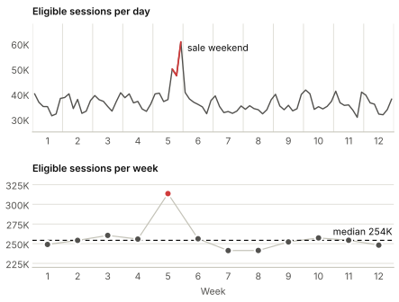
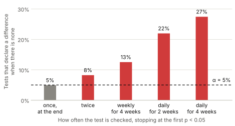

+++
date = '2026-11-09T12:01:00-05:00'
draft = true
title = 'A/B testing, part 2: how long should a two-group test run?'
categories = ['A/B testing']
+++

*This is part 2 of a four-part series on A/B testing in e-commerce. [Part 1](/blog/5-ab-testing-1-hypothesis-tests/) tested a finished two-group test. This post plans one. Parts [3](/blog/7-ab-testing-3-abn-mcb/) and [4](/blog/8-ab-testing-4-abn-test-duration/) repeat both steps for tests with three or more groups.*

In part 1 a store tested a redesigned product page (group B) against the current one (group A) for two weeks. The redesign truly lifted both conversion rate (CR) and revenue per session (RPS) by 5%. The CR test detected the lift and the RPS test did not.

How long a test runs should be decided before it starts. The duration is the number of sessions the test needs divided by the number of sessions the store receives, and the two halves of that fraction are the first two sections of this post. The third section covers what to do when the answer is longer than the business is willing to wait.

## How many sessions the test needs

### Inputs

Four choices fix the sample size. All four are made before the test.

1. **The KPI**, here CR or RPS.
2. **The significance level** $\alpha$: the probability of rejecting $H_0$ when the two pages are in fact equal. We use 0.05.
3. **The minimum detectable effect (MDE)** $\delta$: the smallest true difference $\mu_B - \mu_A$ that would change the decision. Smaller differences are treated as if the two pages were equivalent.
4. **The power** $1-\beta$: the probability that the test rejects $H_0$ when the true difference is exactly $\delta$. We use 0.80.

Power has no meaning without $\delta$. An [earlier post](/blog/3-how-i-think-about-power/) explains why.

### The formula

Part 1's test rejects $H_0$ when $\vert\hat\Delta\vert \gt z_{\alpha/2} \cdot \text{SE}$, where $z_{\alpha/2}$ is the upper $\alpha/2$ quantile of the standard normal (1.960 for $\alpha = 0.05$). With $n$ sessions in each group, $\text{SE}^2 = (\sigma_A^2 + \sigma_B^2)/n$. If the true difference is $\delta$, then $\hat\Delta \approx N(\delta, \text{SE}^2)$ and

$$\text{power} \approx \Phi\left(\frac{\delta}{\text{SE}} - z_{\alpha/2}\right).$$

This equals $1-\beta$ when $\delta/\text{SE} = z_{\alpha/2} + z_\beta$, with $z_\beta$ the upper $\beta$ quantile (0.842 for 80% power). Solving for $n$:

$$n = \frac{(z_{\alpha/2} + z_\beta)^2 (\sigma_A^2 + \sigma_B^2)}{\delta^2}.$$

For $\alpha = 0.05$ and 80% power the first factor is $(1.960 + 0.842)^2 = 7.85$. A [step-by-step derivation](/blog/2-ab-testing-sample-sizing/) is in an earlier post. It evaluates the $z_{\alpha/2}$ term at the null variance, which changes $n$ by less than 2%.

### Which variances to use

$\sigma_A^2$ comes from history. Over the last 12 weeks the current page converted 3.02% of sessions and earned $\\$3.02$ per session with a standard deviation of $\\$24.34$. We plan with 3.0%, $\\$3.00$ and $\\$24.30$. For CR the variance follows from the mean, $\sigma_A^2 = p(1-p) = 0.0291$. For RPS it has to be measured, and a handful of large orders can move it: computed one week at a time, the standard deviation ranged from $\\$23.90$ to $\\$24.90$. Estimate it from several whole weeks.

$\sigma_B^2$ belongs to a page nobody has seen yet. Assuming $\sigma_B^2 = \sigma_A^2$ is called **homogeneity of variance**. To judge the assumption, write a session's revenue as a purchase indicator times an order value with mean $m$ and standard deviation $s_V$. Then

$$\text{Var}(X) = p\left(s_V^2 + m^2\right) - p^2 m^2.$$

This store's orders have $m = s_V = \\$100$. At a conversion rate of 3% the first term is 600 and the second is 9, so the variance is nearly proportional to $p$. The same holds for CR, whose variance is $p(1-p)$. A redesign that lifts conversion by a fraction $\ell$ and leaves order values alone therefore lifts both the mean and the variance of either KPI by about $\ell$:

$$\sigma_B^2 \approx (1+\ell)\sigma_A^2, \qquad n \approx \frac{(z_{\alpha/2} + z_\beta)^2 (2+\ell) \sigma_A^2}{\delta^2}.$$

Assuming homogeneity drops the $\ell$ and understates $n$ by a factor $1 + \ell/2$, which is 2.5% for a 5% lift. For a small effect that works through conversion, homogeneity is an adequate planning assumption: the error is smaller than the uncertainty in the traffic forecast. It is inadequate for a change designed to alter what people buy, such as bundles, a free-shipping threshold or new prices, because the variance of revenue can then move much more than its mean. In that case plan with the larger of the two plausible variances in both groups. The analysis itself never needs the assumption, since Welch's test estimates each variance separately.

### The same formula in relative terms

Stakeholders state the MDE as a lift, $\delta = \ell\mu_A$. Substituting,

$$n \approx \frac{(z_{\alpha/2} + z_\beta)^2 (2+\ell)}{\ell^2} c^2, \qquad c = \frac{\sigma_A}{\mu_A}.$$

$c$ is the **coefficient of variation** of one session's value. It is the only property of the KPI in the formula, and it measures how hard the KPI is to move detectably. For CR, $c^2 = (1-p)/p$, so $c = 5.7$. For RPS, $c = 24.30/3.00 = 8.1$. From the variance formula above, the ratio is

$$\frac{n_{\text{RPS}}}{n_{\text{CR}}} = 1 + \frac{c_V^2}{1-p}, \qquad c_V = \frac{s_V}{m}.$$

$c_V$ is the coefficient of variation of order values. This store has $c_V = 1.0$, so RPS needs about twice the sessions that CR needs for the same lift.

### The numbers

With $\ell = 0.05$:

| | CR | RPS |
| :--- | ---: | ---: |
| $\mu_A$ | 3.00% | $\\$3.00$ |
| $\sigma_A$ | 0.1706 | $\\$24.30$ |
| $\delta$ | 0.15 pp | $\\$0.15$ |
| Sessions per group | 207,935 | 422,271 |
| Sessions in total | 415,870 | 844,543 |

These use the lifted variance for group B. Equal variances would give 203,024 and 411,972 sessions per group.


Because $n$ is proportional to $1/\delta^2$, halving the MDE quadruples the test.

## How many sessions the store gets

Turning a session count into a number of days needs a traffic forecast. Four things make that harder than dividing by yesterday's traffic.

**Only eligible sessions count.** A session contributes to the test only if it could have been shown the redesign. Here that means sessions that reach a product page, counted with the same 30-minute rule the analysis uses. If the test is given only part of the eligible traffic, scale by that share.

**Traffic has a weekly rhythm.**



Sundays and Mondays bring 15% to 20% more sessions than Fridays. Weekday and weekend shoppers also differ in what they buy and how readily, so a test that covers Monday to Thursday measures a different population from one that covers a full week. Run tests for whole weeks. The same applies to the baseline: estimate $\mu_A$ and $\sigma_A$ from whole weeks too. Whole weeks also simplify the forecast, which then only has to predict weekly totals, and those vary far less than daily counts.

**The calendar intervenes.** Week 5 contains a sale weekend with 40% more sessions than usual, and those sessions come from shoppers who behave differently. Schedule tests away from sales, holidays and large campaigns, or accept that the result describes those conditions.

**The forecast is uncertain.** A plan that needs average traffic fails half the time. Let $W$ be the median of the weekly totals, 254K. Let $S$ be 1.4826 times the median absolute deviation from $W$, which estimates the standard deviation of a typical week and ignores the sale week: 6.1K, or 2.4% of $W$. (The ordinary standard deviation is 18.8K, almost all of it from that one week.) If weeks vary independently, the total over $T$ weeks has mean $TW$ and standard deviation $S\sqrt{T}$, and its 10th percentile is

$$N_{10}(T) = TW - 1.28 S\sqrt{T}.$$

Run the test for the smallest whole number of weeks $T$ with $N_{10}(T)$ at least the total required. The store then reaches its sample size on schedule nine times out of ten.


A test on CR needs two weeks and a test on RPS needs four.

Three remarks on this forecast. It assumes the coming weeks resemble the last twelve, so a trend or a known event has to be added by hand. Its spread comes from history because the variation that matters is driven by campaigns, weather and the calendar. Pure counting noise is negligible: for 36,700 sessions a day it is about 190 sessions. And if traffic falls short anyway, extend the test by whole weeks until the planned count is reached. A stopping rule that depends only on session counts, never on the KPI, leaves the error rates of the test intact.

## When the business wants the answer sooner

Suppose the people who commissioned the test care about revenue and want a decision in two weeks. The plan says four. This is the situation part 1's test was run in.

### State what two weeks buys

Two weeks deliver 497K sessions, 249K per group. Inverting the sample size formula gives the power of that test at any true lift.


In two weeks the RPS test reliably detects lifts of 6.5% or more, and it finds a 5% lift a little more often than a coin flip would. Part 1's outcome is a common one: in repeated simulations of that test, CR is significant while RPS is not in 30% of runs.

Put those numbers in front of the decision makers before the test. A two-week RPS test is a legitimate choice if a lift below 6.5% would not be worth shipping anyway. It is a poor one if the redesign is expected to be worth 3%.

### Shorten the test

Each row shows the factor by which a change multiplies the 845K sessions that the RPS test needs.

| Change | Sessions needed |
| :--- | ---: |
| Decide on CR, keep RPS as a guardrail | × 0.49 |
| MDE of 7% instead of 5% | × 0.52 |
| $\alpha = 0.10$ instead of 0.05 | × 0.79 |
| Power of 0.70 instead of 0.80 | × 0.79 |
| Cap each order at the 99th percentile ($\\$490$) | × 0.90 |
| Split traffic 80/20 instead of 50/50 | × 1.56 |

The first row is the largest gain and the most common choice. CR becomes the KPI that decides the test, and RPS is checked only for harm. The cost is a blind spot: a redesign that converts more sessions into smaller orders can raise CR while lowering RPS, and a two-week test would reliably detect an RPS loss only if it exceeded about 6.5%.

The MDE can be raised only if lifts below the new value are not worth acting on. Lowering power or raising $\alpha$ trades sessions for a higher chance of a wrong decision, and whoever owns the decision should make that trade knowingly. A one-sided test at $\alpha = 0.05$ saves the same 21% as a two-sided test at 0.10. It is appropriate only when a significant result in favor of A would lead to the same action as no result at all.

Capping replaces every order value above a chosen ceiling by the ceiling, which removes the variance contributed by rare, very large orders. The KPI becomes capped RPS. The gain here is 10% because this store's order values are only moderately skewed. Stores with occasional bulk orders gain far more.

The last row runs the other way. With a share $r$ of the traffic in one group, the test needs $1/(4r(1-r))$ times the sessions of an even split, so protecting the control with an 80/20 split costs 56% more traffic. Dilution costs traffic in a similar way. Suppose only a fraction $f$ of the analyzed sessions could have seen the change. The difference in means shrinks by the factor $f$. If the unexposed sessions buy about as often as the exposed ones, as when a change shown only on mobile is analyzed over all devices, the variance does not shrink and the test takes about $1/f$ times as long as one restricted to exposed sessions. If the unexposed sessions hardly buy at all, as with sessions that never reach a product page, they add little variance and little is lost. Restricting the analysis to sessions that could have seen the change never hurts.

One popular technique is unavailable here. Adjusting for each shopper's behavior before the test (CUPED) can cut variance substantially, but it requires following shoppers across sessions. Adjusting for what is known about a session before it is assigned, such as device or traffic source, remains possible and usually gains less.

### Plan one early look

If the business wants the chance to stop at two weeks when the effect is large, build that into the design. A **group-sequential test** fixes the number of looks in advance and raises the bar at each look so that the overall false positive rate stays at $\alpha$. For a look at week 2 and a final analysis at week 4, the O'Brien-Fleming boundaries are

$$\vert z \vert \gt 2.80 \text{ at week 2}, \qquad \vert z \vert \gt 1.98 \text{ at week 4}.$$

The two $z$ statistics are jointly normal with correlation $\sqrt{1/2}$, because the first look uses half of the final data, and the boundaries are chosen so that the probability of crossing either one under $H_0$ is 0.05. The price is small: the final threshold moves from 1.96 to 1.98, and the sessions needed for 80% power rise by 0.8%. In return, with the 501K sessions per group that four weeks deliver, the RPS test stops at week 2 with probability 26% if the true lift is 5%, 66% if it is 7.5%, and 93% if it is 10%.

### Do not peek

The unplanned version of an early look is to check the dashboard every day and stop the first time $p \lt 0.05$. Each look is another chance for noise to cross the threshold.



A related mistake is to run the short test, see $p \gt 0.05$ on RPS, and report that the redesign has no effect on revenue. Report the confidence interval. Part 1's interval for the RPS lift ran from $-1.1$% to $+7.9$%, which rules out very little.

## Summary

1. Agree on the KPI, $\alpha$, power and MDE with the people who own the decision.
2. Estimate the baseline mean and variance from several whole weeks.
3. Compute the sessions needed. Equal variances are an adequate assumption unless the change is meant to alter what people buy.
4. Forecast eligible sessions at a low percentile and round the duration up to whole weeks.
5. If the duration is too long, show what the acceptable duration can detect, then consider a more sensitive KPI, a larger MDE, or one planned early look.
6. Fix the duration and the analysis before the test starts.

[Part 3](/blog/7-ab-testing-3-abn-mcb/) moves to tests with more than two groups, where neither the analysis of part 1 nor the planning of this post carries over unchanged.

## Code

```python
import numpy as np
from scipy.stats import norm

def sessions_per_group(var_a, var_b, delta, alpha=0.05, power=0.80):
    z = norm.ppf(1 - alpha / 2) + norm.ppf(power)
    return z**2 * (var_a + var_b) / delta**2

p, lift = 0.030, 0.05
sessions_per_group(p * (1 - p), p * (1 + lift) * (1 - p * (1 + lift)), lift * p)  # CR: 207,935
sessions_per_group(24.3**2, 24.3**2 * (1 + lift), lift * 3.00)                   # RPS: 422,271

def weeks_needed(total_sessions, weekly_totals, quantile=0.10):
    """Smallest whole number of weeks whose forecast at `quantile` reaches the total."""
    m = np.median(weekly_totals)
    s = 1.4826 * np.median(np.abs(weekly_totals - m))
    weeks = 1
    while weeks * m + norm.ppf(quantile) * s * np.sqrt(weeks) < total_sessions:
        weeks += 1
    return weeks
```

## References

- Jennison, C., & Turnbull, B. W. (2000). *Group Sequential Methods with Applications to Clinical Trials*. Chapman & Hall/CRC.
- Kohavi, R., Tang, D., & Xu, Y. (2020). *Trustworthy Online Controlled Experiments: A Practical Guide to A/B Testing*. Cambridge University Press.
- O'Brien, P. C., & Fleming, T. R. (1979). A multiple testing procedure for clinical trials. *Biometrics*, 35(3), 549-556.
