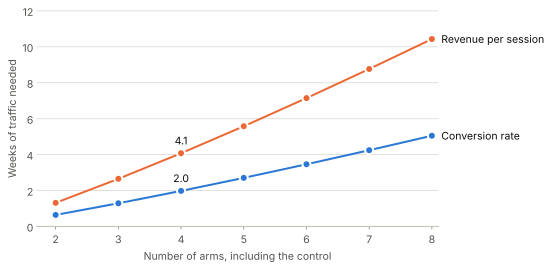

+++
date = '2026-11-09T12:03:00-05:00'
draft = true
title = 'A/B testing, part 4: how long should an A/B/n test run?'
categories = ['A/B testing']
+++

*This is the last part of a four-part series on A/B testing in e-commerce. Parts [1](/blog/5-ab-testing-1-hypothesis-tests/) and [2](/blog/6-ab-testing-2-test-duration/) analyzed and planned a test with two arms. [Part 3](/blog/7-ab-testing-3-abn-mcb/) analyzed a four-arm test with Hsu's multiple comparisons with the best (MCB). This post plans one.*

Part 3's test compared the current product page A with three redesigns B, C and D for four weeks. Its MCB intervals had a margin $w$ of 0.101 percentage points for conversion rate (CR) and $\\$0.144$ for revenue per session (RPS). Those margins decided what the test could say: D was shown to be the best page on CR, and on RPS it could not be separated from C.

This post chooses the duration of such a test in advance. The method is the sample-size computation in Appendix C of Hsu (1996), which the [`mcb`](https://github.com/johnswyou/mcb) package implements.

## Why power does not carry over

In part 2, a test had enough sessions when it rejected $H_0$ with probability $1-\beta$ at a true difference of $\delta$. MCB makes several statements at once and has no single $H_0$ to reject.

The textbook substitute is the power of the F-test, the probability of rejecting the hypothesis that all arms are equal. Hsu's objection is that this power counts every rejection as a success, including the cases in which the statements made afterwards about which arm is best are wrong. He proposes a different target: choose $n$ so that, with high probability, the confidence intervals are both **correct** (all of them contain their true values) and **useful** (they are narrow enough to support the decision).

## What "useful" means

Recall the MCB interval for arm $i$ when every arm has $n$ sessions. With $e_i = \hat\mu_i - \max_{j \neq i}\hat\mu_j$ the estimate of $\theta_i$,

$$D_i^- = \min(0, \enspace e_i - w), \qquad D_i^+ = \max(0, \enspace e_i + w), \qquad w = d\hat\sigma\sqrt{2/n}.$$

The planner supplies one new number, the **indifference margin** $\delta^\ast$: the largest shortfall from the best arm that would be acceptable in the page that ships. A page within $\delta^\ast$ of the best is as good as the best for the purposes of the decision. Like the MDE in part 2, $\delta^\ast$ is a business input. The intervals are useful when $w \lt \delta^\ast$.

If all intervals contain their true values and $w \lt \delta^\ast$, two conclusions are guaranteed:

1. **The arm with the highest sample mean is less than $\delta^\ast$ below the best arm.** For this arm $e_i \ge 0$, so $D_i^- \ge -w \gt -\delta^\ast$. The interval contains $\theta_i$, hence $\theta_i \gt -\delta^\ast$.
2. **Every arm more than $2\delta^\ast$ below the best is ruled out.** For such an arm $\theta_i \lt -2\delta^\ast$. The interval contains $\theta_i$, so $e_i - w \lt -2\delta^\ast$, which gives $e_i + w \lt 2w - 2\delta^\ast \lt 0$ and therefore $D_i^+ = 0$.

The margin splits the arms into three zones by their true distance from the best.


The figure places the four pages of part 3 by their true conversion rates, with $\delta^\ast = 0.15$ percentage points. A planner does not know where the arms fall. The guarantee holds wherever they do.

## The probability of correct and useful inference

Part 3 showed that all intervals contain their true values whenever an event $E$ occurs, where $E$ has probability exactly $1-\alpha$. The planning quantity is the probability that $E$ occurs and $w \lt \delta^\ast$. Under the one-way normal model with $k$ arms it equals

$$P(n) = \int_0^u \int_{-\infty}^{\infty} \left[\Phi\left(z + \sqrt{2} d s\right)\right]^{k-1} d\Phi(z) \enspace \gamma_\nu(s) ds, \qquad u = \sqrt{\frac{n}{2}} \cdot \frac{\delta^\ast}{d\sigma}.$$

This is equation (C.3) of Hsu (1996). Its pieces:

- $z$ is the standardized error of the best arm's sample mean, and $s = \hat\sigma/\sigma$ has density $\gamma_\nu$ with $\nu = k(n-1)$ degrees of freedom.
- Given $z$ and $s$, the event $E$ requires each of the other $k-1$ arms' standardized errors to fall below $z + \sqrt{2}ds$. They are independent, which gives the bracket raised to the power $k-1$.
- Integrating over all $s \gt 0$ would give exactly $1-\alpha$, by the definition of $d$. The condition $w \lt \delta^\ast$ is the same as $s \lt u$, so stopping the integral at $u$ keeps only the useful outcomes.

$P(n)$ is therefore below $1-\alpha$ and approaches it as $n$ grows. The sample size is the smallest $n$ with $P(n) \ge 1-\beta$, for a target $1-\beta$ chosen below $1-\alpha$. We use $\alpha = 0.05$ and a target of 0.90, as Hsu does.


The two panels differ in how well $\hat\sigma$ estimates $\sigma$. With a handful of observations per arm $\hat\sigma$ is noisy, the width of the intervals is uncertain, and $P(n)$ rises slowly. With hundreds of thousands of normal observations $\hat\sigma$ would be within 0.1% of $\sigma$, so $w \lt \delta^\ast$ holds almost surely or almost never, depending on which side of

$$n_0 = 2\left(\frac{d\sigma}{\delta^\ast}\right)^2$$

the sample size falls. At $n_0$ the probability is 0.47, because $\hat\sigma$ exceeds $\sigma$ half the time. One percent above $n_0$ it is 0.95. For a test of this size the whole computation reduces to $n_0$, and the choice of target hardly matters. What matters is the value of $\sigma$ that goes into $n_0$, because $w \lt \delta^\ast$ compares the $\hat\sigma$ the test will produce with the $\sigma$ used for planning. The planning section below returns to this.

## How this relates to part 2

Part 2's formula under equal variances was $n = 2\sigma^2(z_{\alpha/2} + z_\beta)^2/\delta^2$. The MCB formula is $n_0 = 2\sigma^2 d^2/{\delta^\ast}^2$. Both multiply $2\sigma^2$ by the square of a critical constant over a margin.

For two arms the correspondence is exact. Then $d = z_\alpha = 1.645$, and

$$n_0 = \frac{2\sigma^2 z_\alpha^2}{{\delta^\ast}^2} = \frac{2\sigma^2 (z_\alpha + z_\alpha)^2}{(2\delta^\ast)^2},$$

which is part 2's sample size for a one-sided test with level $\alpha$, power $1-\alpha$ and MDE $2\delta^\ast$. Two things follow. The quantity that corresponds to part 2's MDE is $2\delta^\ast$, not $\delta^\ast$. And Hsu's guarantee is a demanding one: it protects against failing to rule out an arm $2\delta^\ast$ below the best as strictly as it protects against a false statement.

The analogue of part 2's power curve is the probability that an arm is ruled out, as a function of its true distance $g$ below the best. The arm is certainly ruled out when the best arm's sample mean beats its own by $w$ or more. If $w$ comes out equal to $\delta^\ast$, the standard error of that difference is $\delta^\ast/d$ and

$$P(\text{ruled out}) \approx \Phi\left(\frac{g - \delta^\ast}{\delta^\ast/d}\right) = \Phi\left(d\left(\frac{g}{\delta^\ast} - 1\right)\right).$$


An arm exactly $\delta^\ast$ below the best is ruled out half the time, and an arm $2\delta^\ast$ below is ruled out 98% of the time when $k = 4$. A narrower $w$ moves every point up. The curve also translates a requirement stated in the language of power. To rule out an arm $g$ below the best with probability $1-\beta$, set

$$\delta^\ast = \frac{g}{1 + z_\beta/d}.$$

For 80% and four arms this is $\delta^\ast = 0.71g$.

## Planning the store's test

Three of the inputs are settled: $k = 4$, $\alpha = 0.05$, target 0.90.

**The margin.** Take $\delta^\ast$ to be 5% of A's mean: 0.15 percentage points of CR and $\\$0.15$ of RPS. Part 2 treated pages less than 5% apart as equivalent, and this margin says the same.

**The standard deviation.** Because $w \lt \delta^\ast$ holds only if $\hat\sigma$ comes out below the planning value, $\sigma$ should be an upper value, for two reasons.

The first is that $\hat\sigma$ pools all arms, and part 2 showed that variance rises with the mean. A page that lifts the KPI by 10%, the most the team considers plausible, has a variance of $1.10\sigma_A^2$. We plan as if every page were that good.

The second is that $\hat\sigma$ is noisier than the model says. For normal data its relative standard deviation is $1/\sqrt{2N}$, where $N = kn$ is the total number of sessions. In general it is

$$\frac{\text{SD}(\hat\sigma)}{\sigma} \approx \frac{1}{2}\sqrt{\frac{\kappa - 1}{N}},$$

where $\kappa$ is the kurtosis of one session's value: 3 for a normal variable, 31 for the purchase indicator at a 3% conversion rate, and about 490 for this store's revenue per session. At the sample sizes below that is 0.4% for CR and 1.1% for RPS, where the normal model gives 0.1%. Adding 1.645 of these standard deviations keeps $\hat\sigma$ below the planning value in 95% of tests. The planning values are

$$\sigma_{\text{CR}} = 0.1706 \times \sqrt{1.10} \times 1.0065 = 0.1801, \qquad \sigma_{\text{RPS}} = 24.30 \times \sqrt{1.10} \times 1.0184 = 25.95.$$

A planning value that turns out too low does limited damage. If $\hat\sigma$ exceeds it by 1%, $w$ exceeds $\delta^\ast$ by 1%, and the intervals remain correct.

```python
from mcb import constrained_mcb_sample_size

constrained_mcb_sample_size(k=4, delta_star=0.0015, sigma=0.1801, alpha=0.05, target=0.90)  # 123,004
constrained_mcb_sample_size(k=4, delta_star=0.15, sigma=25.95, alpha=0.05, target=0.90)     # 255,109
```

**The traffic.** The forecast is the one from part 2: the 10th percentile of cumulative eligible sessions, 497K after two weeks, 1,001K after four and 1,254K after five.

| | CR | RPS |
| :--- | ---: | ---: |
| $\sigma$ | 0.1801 | $\\$25.95$ |
| $\delta^\ast$ | 0.15 pp | $\\$0.15$ |
| Sessions per arm | 123,004 | 255,109 |
| Sessions in total, four arms | 492,016 | 1,020,436 |
| Weeks | 2 | 5 |
| Part 2's two-arm test, sessions in total | 415,870 | 844,543 |

The four-arm test needs about 20% more traffic than part 2's two-arm test. The similarity is misleading, because the two plans promise different things. Part 2's test detects a 5% difference between two pages with probability 80%. This plan rules out a page 5% below the best with probability about 50%, and a page 10% below with probability at least 98%.

The like-for-like plan gives a page 5% below the best an 80% chance of being ruled out, which requires $\delta^\ast = 0.71 \times 5 = 3.55$%. That test needs 975K sessions for CR and 2.02M for RPS, or four weeks and nine weeks. It is 2.3 to 2.4 times the traffic of the two-arm test: twice the arms cost somewhat more than twice the traffic for the same resolution.

### Checking the plan

Hsu's probability assumes normal data, so the plan is worth checking against the store's. In 4,000 simulated tests at the planned sizes, with every page near a 10% lift and one of them slightly ahead (the least favorable case the plan allows for), all intervals were correct and $w$ was below $\delta^\ast$ in 94% of tests for CR and 92% for RPS. Both exceed the target of 0.90. With the true means of part 3 the figure is 95% for both KPIs.

The upper value of $\sigma$ is what makes this work. A plan based on the expected pooled variance, $1.05\sigma_A^2$, with no allowance for the noise in $\hat\sigma$, asks for 115K and 234K sessions per arm, and $w$ then lands below $\delta^\ast$ in only 47% of simulated tests. The practical damage is small: the two conclusions still hold in 99% of those tests, because missing $\delta^\ast$ by a percent rarely changes a conclusion. But the stated guarantee is not met.

Part 3's test fits the plan. Its four weeks of traffic ran ahead of the 10th-percentile forecast and delivered 256K sessions per arm, just above the 255K planned for RPS and twice the plan for CR. The pooled standard deviation of revenue came out at $\\$25.02$, below the planning value, and $w$ was $\\$0.144$ against a $\delta^\ast$ of $\\$0.15$. Both conclusions held on both KPIs. On RPS, the leader D had a lower bound of $-\\$0.037$, well inside $-\delta^\ast$, and A, the only page more than $2\delta^\ast$ below the best, was ruled out.

## What each arm costs

The duration is $k \cdot n$ divided by the traffic. Adding an arm raises $n$ slightly, through $d$, and raises $k$.



At this store each additional arm adds about five days to a CR test and ten days to an RPS test. Removing the weakest candidate before the test is the cheapest way to shorten it.

## When the business wants the answer sooner

The options parallel those of part 2. Each row changes one input of the plan.

| Plan | Weeks, CR | Weeks, RPS |
| :--- | ---: | ---: |
| Four arms, $\delta^\ast = 5$%, $\alpha = 0.05$ | 2 | 5 |
| $\delta^\ast = 7.5$% | 1 | 2 |
| $\delta^\ast = 3.55$% | 4 | 9 |
| Three arms | 2 | 3 |
| Six arms | 4 | 8 |
| $\alpha = 0.10$, with the target lowered to 0.85 | 2 | 3 |

The last row lowers the target because it must stay below $1-\alpha$.

As in part 2, start by stating what the available time buys. Two weeks give 124K sessions per arm, for which $w$ is at most 5.0% of A's mean for CR and 7.2% for RPS. A two-week RPS test therefore selects a page within 7.2% of the best and rules out pages more than about 14% below it. If that resolution is acceptable, two weeks suffice.

If it is not, the levers in order of size are the margin, the number of arms and the KPI. Deciding on CR and treating RPS as a guardrail cuts the duration by more than half here, with the same blind spot as in part 2 for redesigns that trade order value for conversions.

A test that ends with more than one candidate has still produced a decision rule. Conclusion 1 says the arm with the highest sample mean is within $\delta^\ast$ of the best, so shipping it is the planned outcome. Part 3's RPS result is an example.

What does not work is shortening the test informally, by dropping arms along the way or stopping when the leader looks convincing. The guarantees above belong to a design fixed in advance.

One limit of the method: Appendix C covers equal arm sizes only. The analysis of part 3 accepts unequal arms, and the planning does not.

## The series in one table

| | Reading the result | Planning the duration |
| :--- | :--- | :--- |
| Two arms | Welch's test: reject $H_0$ when $\vert\hat\Delta\vert \gt z_{\alpha/2} \cdot \text{SE}$ | $n = (z_{\alpha/2} + z_\beta)^2(\sigma_A^2 + \sigma_B^2)/\delta^2$ |
| $k$ arms | MCB: intervals for $\theta_i$ with margin $w = d\hat\sigma\sqrt{2/n}$ | $n = 2(d\sigma/\delta^\ast)^2$, with $\sigma$ an upper value |

In every cell, CR and RPS are handled by the same formula with a different variance, and RPS needs about twice the sessions.

## References

- Bechhofer, R. E. (1954). A single-sample multiple decision procedure for ranking means of normal populations with known variances. *The Annals of Mathematical Statistics*, 25, 16-39.
- Hsu, J. C. (1988). Sample size computation for designing multiple comparison experiments. *Computational Statistics & Data Analysis*, 7, 79-91.
- Hsu, J. C. (1996). *Multiple Comparisons: Theory and Methods*. Chapman & Hall. Appendix C covers sample size.
